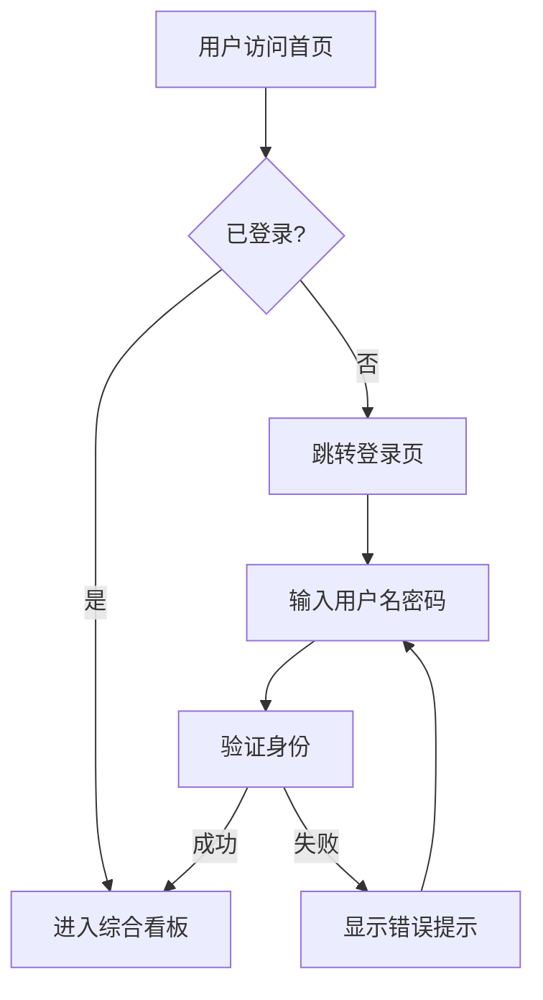
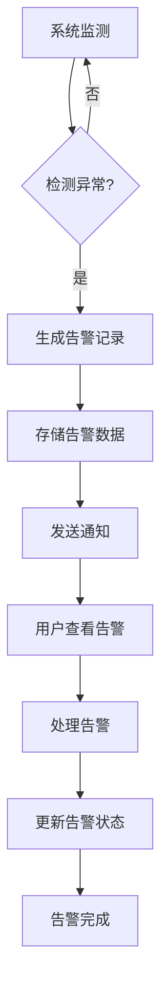
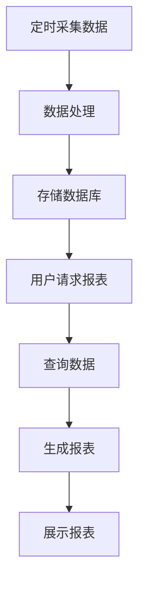
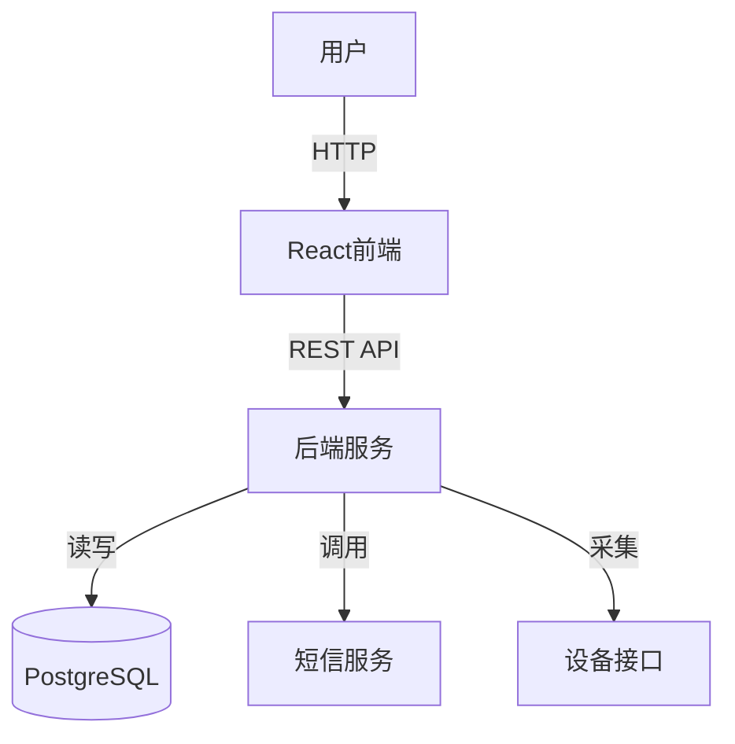
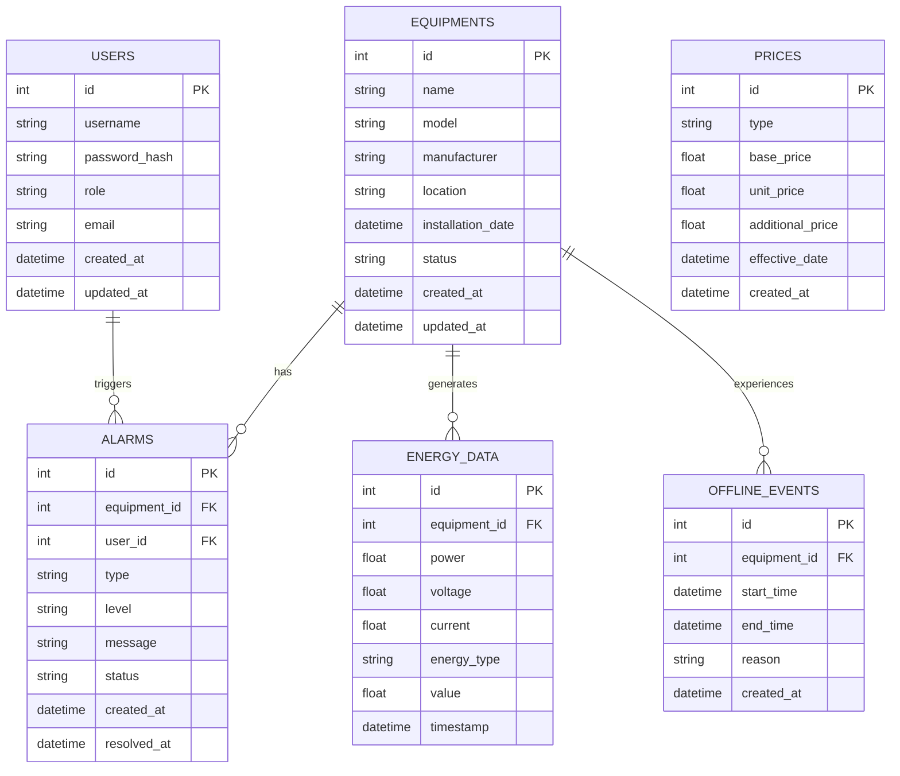

# EMS能源管理系统 - 产品需求文档

---

## 1. 产品概述

EMS能源管理系统是一款面向工业企业的能源监控与管理平台，旨在帮助企业实现能源消耗的实时监测、智能分析和科学管理，从而降低能耗成本、提升能源利用效率。

- **核心价值**: 通过实时数据采集、智能分析和可视化展示，帮助企业全面掌握能源消耗状况，发现节能潜力，实现精细化能源管理
- **目标用户**: 工业企业能源管理部门、运维人员、企业管理层
- **市场定位**: 中大型工业企业的能源管理解决方案

---

## 2. 核心功能

### 2.1 用户角色

| 角色 | 登录方式 | 核心权限 |
|------|---------|---------|
| 管理员 | 用户名密码登录 | 完整系统权限，包括设备管理、价格配置、用户管理 |
| 运维人员 | 用户名密码登录 | 实时监控、告警处理、数据查询 |
| 普通用户 | 用户名密码登录 | 数据查看、报表浏览 |

### 2.2 功能模块

1. **综合看板**: 核心数据概览、实时监控、关键指标展示
2. **实时监控**: 配电监测、变压器监测、分类能耗监测、参数查询、离线事件
3. **告警管理**: 设备故障、用能预警、报警分级、报警分析、短信日志
4. **能耗统计**: 集抄报表、运行报表、分时段报表、数据补录、电费/水费统计
5. **能耗分析**: 能源流向、状态分析、同比/环比分析、最大需量分析、损耗分析
6. **系统管理**: 价格管理、设备管理、通讯状态监控

### 2.3 页面详情

| 页面名称 | 模块名称 | 功能描述 |
|---------|---------|---------|
| 登录页 | 登录模块 | 用户身份验证，支持管理员/用户登录 |
| 综合看板 | 数据概览 | 今日用电量、用水量、电费支出、待处理告警等核心指标 |
| | 趋势图表 | 24小时用电趋势、分类能耗占比、近7日能耗对比 |
| | 告警列表 | 最新待处理告警信息展示 |
| 配电监测 | 配电数据 | 实时展示进线/出线电流、电压、功率数据 |
| 变压器监测 | 变压器状态 | 温度、负载率、电流、电压实时监测 |
| 分类能耗监测 | 能耗分类 | 按部门/车间展示能耗分布 |
| 监测参数查询 | 参数检索 | 按设备、时间范围查询历史监测数据 |
| 离线事件 | 事件记录 | 设备离线时间、原因记录与查询 |
| 设备故障 | 故障管理 | 故障告警列表、状态筛选、处理操作 |
| 用能预警 | 预警管理 | 用能异常预警信息展示与处理 |
| 报警分级 | 分级统计 | 按严重程度（严重/一般/轻微）统计报警 |
| 报警分析 | 趋势分析 | 报警趋势图表、类型分布统计 |
| 短信日志 | 通知记录 | 告警短信发送记录查询 |
| 集抄报表 | 抄表汇总 | 电表抄表数据汇总报表 |
| 运行报表 | 运行统计 | 设备运行状态统计分析 |
| 分时段报表 | 时段分析 | 峰谷平时段能耗对比 |
| 能耗数据补录 | 数据补全 | 手动补录缺失能耗数据 |
| 电度电费 | 电费计算 | 电费明细与汇总统计 |
| 力调电费 | 功率因数 | 力调电费计算展示 |
| 综合水费 | 水费统计 | 水费明细与汇总 |
| 能源流向图 | 流向可视化 | 能源流向示意图 |
| 能耗状态分析 | 状态评估 | 能耗健康度分析 |
| 能耗同比分析 | 年度对比 | 与去年同期能耗对比 |
| 能耗环比分析 | 月度对比 | 与上月能耗对比 |
| 最大需量分析 | 需量统计 | 最大需量分析与预测 |
| 损耗分析 | 损耗计算 | 能耗损耗分析 |
| 用能价格管理 | 价格配置 | 电价、水价参数设置 |
| 设备管理 | 设备台账 | 设备信息增删改查 |
| 通讯状态图 | 通讯监控 | 系统通讯状态可视化 |
| 仪表通讯状态 | 仪表监控 | 各仪表连接状态 |
| 网关通讯状态 | 网关监控 | 网关连接状态 |

---

## 3. 核心流程

### 3.1 用户登录流程

### 3.2 告警处理流程

### 3.3 数据统计流程

---

## 4. 用户界面设计

### 4.1 设计风格

- **主色调**: 蓝色系（#3b82f6）- 科技感、专业、可信赖
- **辅助色**: 
  - 青色（#06b6d4）- 水相关模块
  - 绿色（#22c55e）- 成功状态、正向指标
  - 红色（#ef4444）- 告警、错误状态
  - 黄色（#eab308）- 警告状态
- **按钮样式**: 圆角矩形（rounded-lg），主按钮渐变背景，悬停阴影效果
- **字体**: 中文使用PingFang SC/微软雅黑，英文使用Inter
- **布局**: 左侧固定导航栏 + 右侧内容区域的经典后台管理布局
- **图标**: Lucide React图标库，线性风格

### 4.2 页面设计概述

| 页面名称 | 模块名称 | UI元素 |
|---------|---------|--------|
| 登录页 | 登录表单 | 用户名/密码输入框、登录按钮、Logo展示 |
| 综合看板 | 统计卡片 | 卡片布局、图标、数值、趋势指示 |
| | 图表区域 | 折线图、柱状图、环形图 |
| | 告警列表 | 优先级标签、时间、描述 |
| 侧边导航 | 菜单系统 | 可折叠菜单、展开动画、激活状态高亮 |
| 功能页面 | 数据表格 | 分页、筛选、排序功能 |
| | 图表组件 | 响应式、交互提示 |

### 4.3 响应式设计

- **桌面端（≥1280px）**: 完整功能展示，侧边栏展开显示完整菜单
- **平板端（768px-1279px）**: 侧边栏自动折叠为图标模式，悬停展开
- **移动端（<768px）**: 侧边栏转为抽屉式，顶部菜单按钮控制

### 4.4 交互设计

- 页面切换平滑过渡动画
- 图表悬停显示详细数据tooltip
- 表格支持点击排序
- 告警卡片点击查看详情
- 按钮悬停效果增强
- 表单实时验证反馈

---

## 5. 技术架构

### 5.1 架构设计

### 5.2 技术选型

| 分类 | 技术 | 版本 |
|------|------|------|
| 前端框架 | React | 18.x |
| 语言 | TypeScript | 5.x |
| 构建工具 | Vite | 6.x |
| 样式 | TailwindCSS | 3.x |
| 状态管理 | Zustand | 5.x |
| 路由 | React Router | 7.x |
| 图表 | Chart.js + react-chartjs-2 | 4.x/5.x |
| 图标 | Lucide React | 0.x |

### 5.3 路由定义

| 路由 | 页面组件 | 说明 |
|------|---------|------|
| /login | Login | 用户登录 |
| / | Dashboard | 综合看板（首页） |
| /real-time/power-distribution | PowerDistribution | 配电监测 |
| /real-time/transformer | Transformer | 变压器监测 |
| /real-time/classified | ClassifiedEnergy | 分类能耗监测 |
| /real-time/query | ParameterQuery | 参数查询 |
| /real-time/offline | OfflineEvents | 离线事件 |
| /alarm/equipment-fault | EquipmentFault | 设备故障 |
| /alarm/energy-warning | EnergyWarning | 用能预警 |
| /alarm/classification | AlarmClassification | 报警分级 |
| /alarm/analysis | AlarmAnalysis | 报警分析 |
| /alarm/sms-log | SmsLog | 短信日志 |
| /statistics/meter-reading | StatisticsMeterReading | 集抄报表 |
| /statistics/operation | StatisticsOperation | 运行报表 |
| /statistics/time-segment | StatisticsTimeSegment | 分时段报表 |
| /statistics/supplement | StatisticsSupplement | 数据补录 |
| /statistics/electric-fee | StatisticsElectricFee | 电度电费 |
| /statistics/power-factor | StatisticsPowerFactor | 力调电费 |
| /statistics/water-fee | StatisticsWaterFee | 综合水费 |
| /analysis/flow | AnalysisFlow | 能源流向图 |
| /analysis/status | AnalysisStatus | 能耗状态分析 |
| /analysis/yoy | AnalysisYOY | 同比分析 |
| /analysis/mom | AnalysisMOM | 环比分析 |
| /analysis/max-demand | AnalysisMaxDemand | 最大需量分析 |
| /analysis/loss | AnalysisLoss | 损耗分析 |
| /system/price | SystemPrice | 价格管理 |
| /system/equipment | EquipmentManagement | 设备管理 |
| /system/communication | SystemGatewayStatus | 通讯状态图 |
| /system/meter-status | SystemMeterStatus | 仪表通讯状态 |
| /system/gateway-status | SystemGatewayStatus | 网关通讯状态 |

### 5.4 数据模型

---

## 6. 非功能需求

### 6.1 性能要求

- 页面加载时间 ≤ 2秒
- 实时数据刷新间隔 ≤ 5秒
- 图表渲染时间 ≤ 1秒
- 支持1000+设备同时在线

### 6.2 安全要求

- 用户密码采用bcrypt加密存储
- 接口调用使用JWT身份验证
- 不同角色有严格的权限控制
- 敏感数据传输采用HTTPS
- 防止SQL注入、XSS攻击

### 6.3 可用性要求

- 系统可用性 ≥ 99.9%
- 数据备份频率：每日全量备份 + 每小时增量备份
- 故障恢复时间 ≤ 30分钟

---

## 7. 版本计划

| 版本 | 时间 | 功能范围 |
|------|------|---------|
| V1.0 | 第1-2周 | 基础框架、登录、综合看板、实时监控核心功能 |
| V1.1 | 第3-4周 | 告警管理模块完整功能 |
| V1.2 | 第5-6周 | 能耗统计模块完整功能 |
| V1.3 | 第7-8周 | 能耗分析模块完整功能 |
| V1.4 | 第9-10周 | 系统管理模块、性能优化、测试 |

---

## 附录：核心业务指标

| 指标名称 | 说明 | 计算方式 |
|---------|------|---------|
| 总用电量 | 当日累计用电量 | 各设备用电量之和 |
| 总用水量 | 当日累计用水量 | 各水表读数之和 |
| 电费支出 | 当日电费金额 | 用电量 × 电价 |
| 水费支出 | 当日水费金额 | 用水量 × 水价 |
| 待处理告警 | 未解决告警数量 | 状态为pending的告警数 |
| 峰值功率 | 当日最大功率 | 当日功率最大值 |
| 平均功率 | 当日平均功率 | 总用电量 / 时间 |
