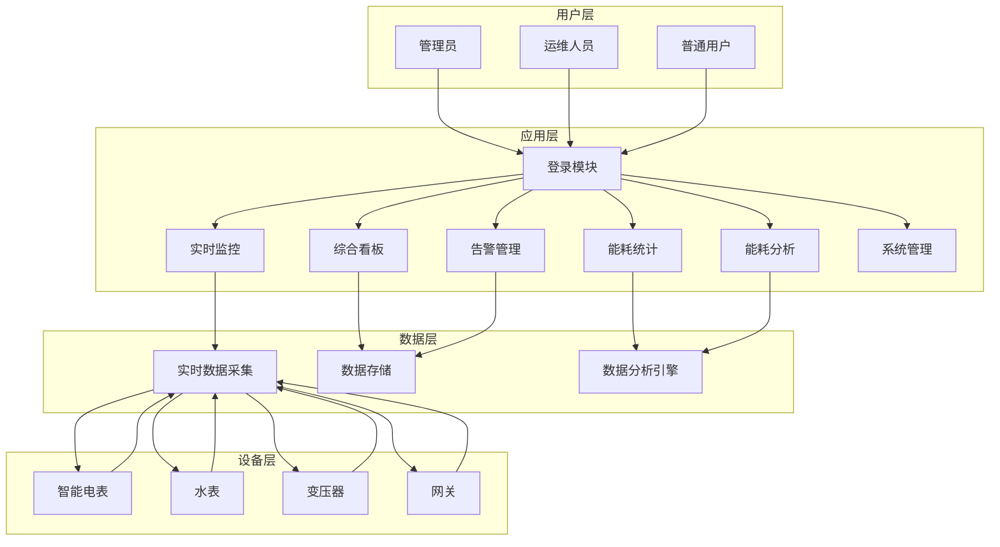
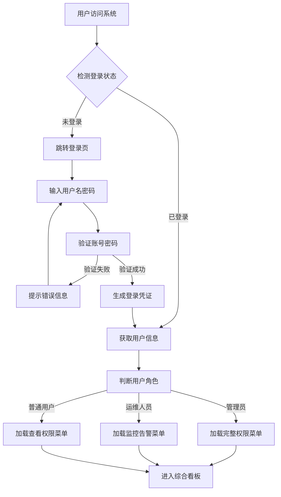
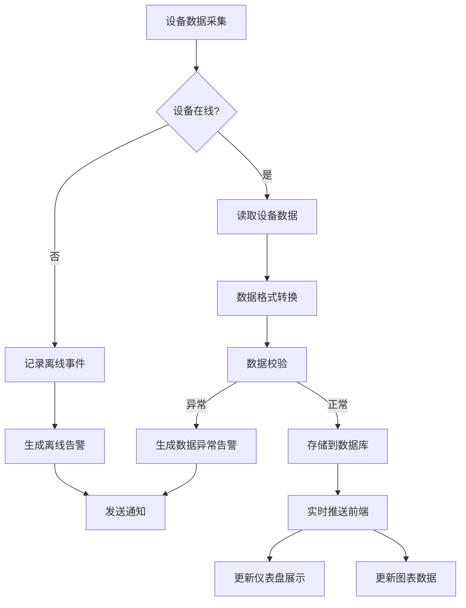
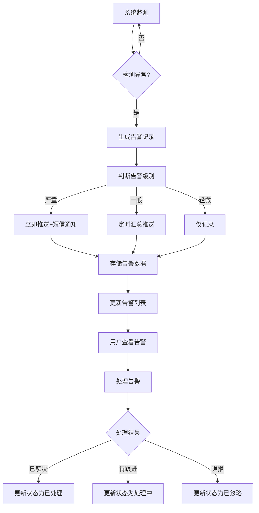
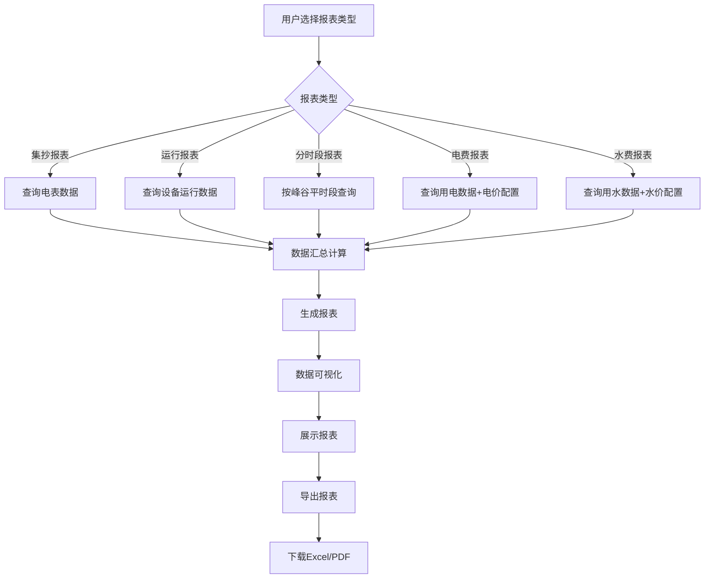
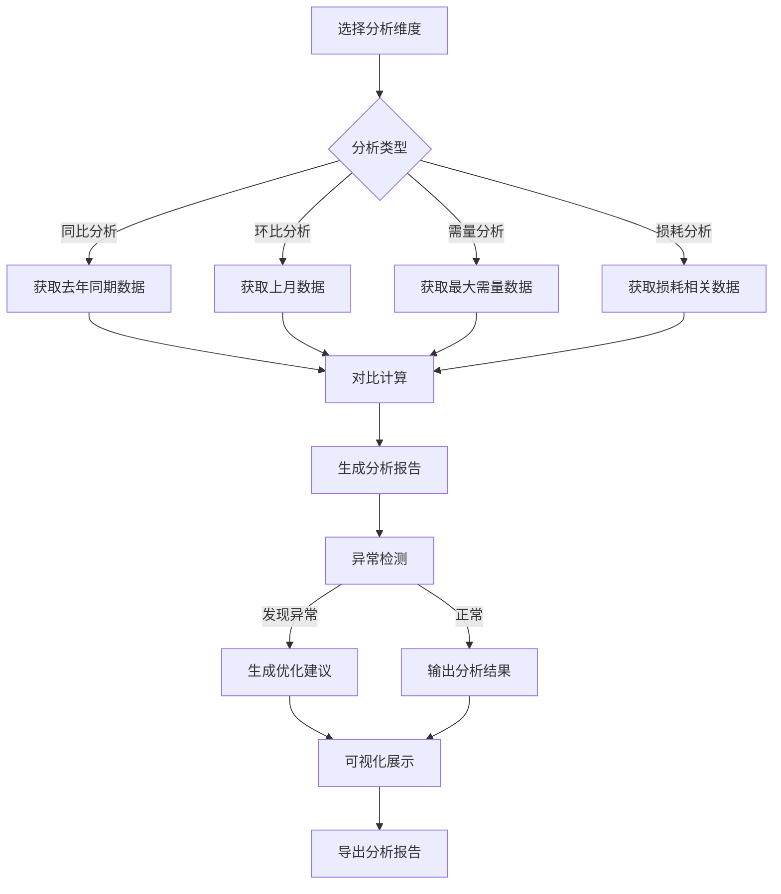
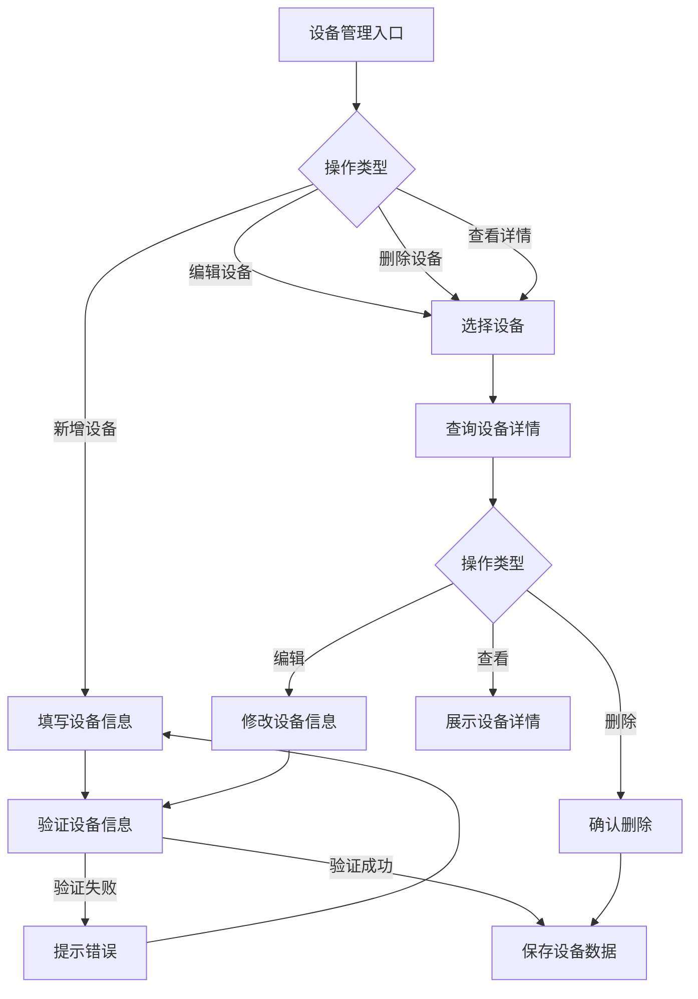
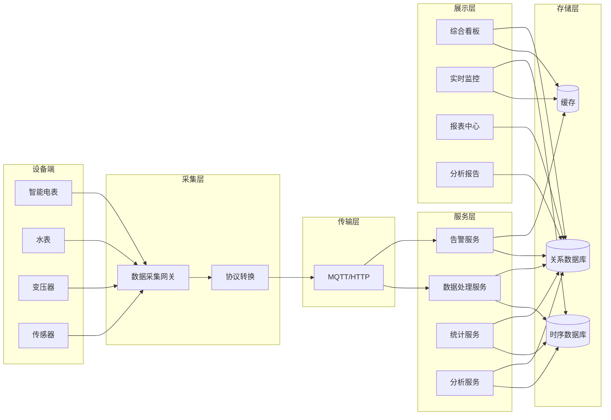
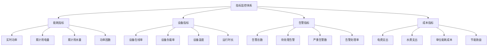
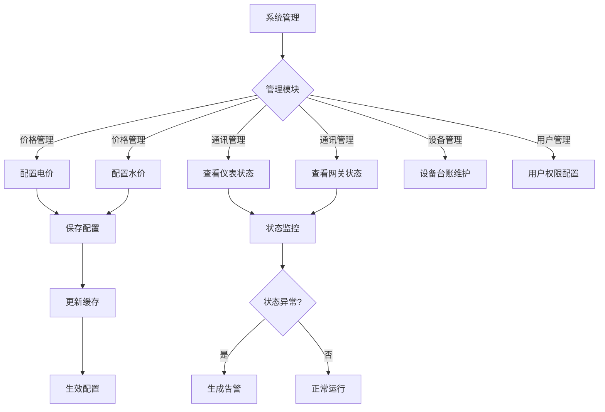

# EMS能源管理系统 - 业务流程图

---

## 一、整体业务架构

---

## 二、核心业务流程

### 1. 用户登录与权限验证流程

### 2. 实时数据采集与展示流程

### 3. 告警管理流程

### 4. 能耗统计报表流程

### 5. 能耗分析流程

### 6. 设备管理流程

---

## 三、数据流向图

---

## 四、关键业务指标监控

---

## 五、系统管理流程

